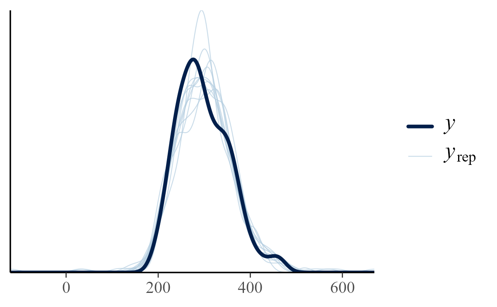

This note is a stopgap demo of how to use a
[stanli](https://github.com/seantalts/stanli) backend with brms until
the next version of brms (something newer than 2.23.0) comes out. (brms
[\#1966](https://github.com/paul-buerkner/brms/pull/1966) added an
official stanli backend, and it was merged into the master branch of
brms.)

Set up and install stanli:

<!--

``` r
install.packages("stanli", repos = c("https://seantalts.r-universe.dev"))
library(stanli)
stanli_install()
```
-->
<pre class='chroma'>
<span><span class='nf'><a href='https://rdrr.io/r/utils/install.packages.html'>install.packages</a></span><span class='o'>(</span><span class='s'>"stanli"</span>, repos <span class='o'>=</span> <span class='nf'><a href='https://rdrr.io/r/base/c.html'>c</a></span><span class='o'>(</span><span class='s'>"https://seantalts.r-universe.dev"</span><span class='o'>)</span><span class='o'>)</span></span>
<span><span class='kr'><a href='https://rdrr.io/r/base/library.html'>library</a></span><span class='o'>(</span><span class='nv'><a href='https://github.com/seantalts/stanli'>stanli</a></span><span class='o'>)</span></span>
<span><span class='nf'><a href='https://rdrr.io/pkg/stanli/man/stanli_install.html'>stanli_install</a></span><span class='o'>(</span><span class='o'>)</span></span></pre>

First, let's fit a normal model with cmdstanr as a point of comparison for 
stanli's performance gains.

The current [demo of brms usage with
stanli](https://github.com/seantalts/stanli/blob/main/docs/teaching.md)
doesn't feature priors or a custom model family, so we will use a
contrived example with both:

<!--

``` r
library(stanli)
library(brms)
# stanli::stanli_install()

# Make a model from scratch
data <- lme4::sleepstudy
formula <- bf(
  Reaction ~ Days + (Days | Subject), 
  # Just to test a non-default family
  family = student()
)

# Loose basis for some priors
lme4::sleepstudy$Reaction |> mean()
#> [1] 298.5079
lme4::sleepstudy$Reaction |> sd()
#> [1] 56.32876
rexp(1000, .01) |> fivenum()
#> [1]   0.04885372  30.38196331  70.14801274 145.45496673 768.92542630
rexp(1000, .10) |> fivenum()
#> [1]  0.01731279  3.01678405  6.65988896 13.43290706 72.51916389
rgamma(1000, .2, .01) |> fivenum()
#> [1] 1.535653e-14 7.973998e-02 2.084129e+00 1.617510e+01 2.501939e+02

priors <- prior(normal(300, 100), class = Intercept) +
  prior(normal(0, 100), class = b) +
  prior(exponential(0.01), class = sigma) +
  prior(exponential(0.01), class = sd, group = Subject, coef = Intercept) +
  prior(exponential(0.10), class = sd, group = Subject, coef = Days) +
  prior(lkj(2), class = cor)

check <- validate_prior(priors, formula, data)

model_cmdstanr <- brm(
  formula = formula, 
  data = lme4::sleepstudy, 
  prior = priors,
  backend = "cmdstanr", 
  cores = 4, 
  file = "2026-11-17-model1",
  file_refit = "on_change",
)

model_cmdstanr
#> Loading required namespace: rstan
#>  Family: student 
#>   Links: mu = identity 
#> Formula: Reaction ~ Days + (Days | Subject) 
#>    Data: lme4::sleepstudy (Number of observations: 180) 
#>   Draws: 4 chains, each with iter = 2000; warmup = 1000; thin = 1;
#>          total post-warmup draws = 4000
#> 
#> Multilevel Hyperparameters:
#> ~Subject (Number of levels: 18) 
#>                     Estimate Est.Error l-95% CI u-95% CI Rhat Bulk_ESS Tail_ESS
#> sd(Intercept)          32.11      6.91    21.21    48.30 1.00     1663     2165
#> sd(Days)                7.08      1.43     4.80    10.46 1.00     1742     2107
#> cor(Intercept,Days)    -0.05      0.24    -0.50     0.43 1.00     1335     1932
#> 
#> Regression Coefficients:
#>           Estimate Est.Error l-95% CI u-95% CI Rhat Bulk_ESS Tail_ESS
#> Intercept   250.94      8.22   234.50   267.77 1.00     1353     1955
#> Days         10.72      1.79     7.20    14.20 1.00     1352     1804
#> 
#> Further Distributional Parameters:
#>       Estimate Est.Error l-95% CI u-95% CI Rhat Bulk_ESS Tail_ESS
#> sigma    15.05      1.84    11.65    18.87 1.00     2632     2397
#> nu        3.36      1.12     1.90     6.19 1.00     3171     2484
#> 
#> Draws were sampled using sample(hmc). For each parameter, Bulk_ESS
#> and Tail_ESS are effective sample size measures, and Rhat is the potential
#> scale reduction factor on split chains (at convergence, Rhat = 1).
```
-->
<pre class='chroma'>
<span><span class='kr'><a href='https://rdrr.io/r/base/library.html'>library</a></span><span class='o'>(</span><span class='nv'><a href='https://github.com/seantalts/stanli'>stanli</a></span><span class='o'>)</span></span>
<span><span class='kr'><a href='https://rdrr.io/r/base/library.html'>library</a></span><span class='o'>(</span><span class='nv'><a href='https://github.com/paul-buerkner/brms'>brms</a></span><span class='o'>)</span></span>
<span><span class='c'># stanli::stanli_install()</span></span>
<span></span>
<span><span class='c'># Make a model from scratch</span></span>
<span><span class='nv'>data</span> <span class='o'>&lt;-</span> <span class='nf'>lme4</span><span class='nf'>::</span><span class='nv'><a href='https://rdrr.io/pkg/lme4/man/sleepstudy.html'>sleepstudy</a></span></span>
<span><span class='nv'>formula</span> <span class='o'>&lt;-</span> <span class='nf'><a href='https://paulbuerkner.com/brms/reference/brmsformula.html'>bf</a></span><span class='o'>(</span></span>
<span>  <span class='nv'>Reaction</span> <span class='o'>~</span> <span class='nv'>Days</span> <span class='o'>+</span> <span class='o'>(</span><span class='nv'>Days</span> <span class='o'>|</span> <span class='nv'>Subject</span><span class='o'>)</span>, </span>
<span>  <span class='c'># Just to test a non-default family</span></span>
<span>  family <span class='o'>=</span> <span class='nf'><a href='https://paulbuerkner.com/brms/reference/brmsfamily.html'>student</a></span><span class='o'>(</span><span class='o'>)</span></span>
<span><span class='o'>)</span></span>
<span></span>
<span><span class='c'># Loose basis for some priors</span></span>
<span><span class='nf'>lme4</span><span class='nf'>::</span><span class='nv'><a href='https://rdrr.io/pkg/lme4/man/sleepstudy.html'>sleepstudy</a></span><span class='o'>$</span><span class='nv'>Reaction</span> <span class='o'>|&gt;</span> <span class='nf'><a href='https://rdrr.io/r/base/mean.html'>mean</a></span><span class='o'>(</span><span class='o'>)</span></span>
<span><span class='c'>#&gt; [1] 298.5079</span></span>
<span><span class='nf'>lme4</span><span class='nf'>::</span><span class='nv'><a href='https://rdrr.io/pkg/lme4/man/sleepstudy.html'>sleepstudy</a></span><span class='o'>$</span><span class='nv'>Reaction</span> <span class='o'>|&gt;</span> <span class='nf'><a href='https://rdrr.io/r/stats/sd.html'>sd</a></span><span class='o'>(</span><span class='o'>)</span></span>
<span><span class='c'>#&gt; [1] 56.32876</span></span>
<span><span class='nf'><a href='https://rdrr.io/r/stats/Exponential.html'>rexp</a></span><span class='o'>(</span><span class='m'>1000</span>, <span class='m'>.01</span><span class='o'>)</span> <span class='o'>|&gt;</span> <span class='nf'><a href='https://rdrr.io/r/stats/fivenum.html'>fivenum</a></span><span class='o'>(</span><span class='o'>)</span></span>
<span><span class='c'>#&gt; [1]   0.04885372  30.38196331  70.14801274 145.45496673 768.92542630</span></span>
<span><span class='nf'><a href='https://rdrr.io/r/stats/Exponential.html'>rexp</a></span><span class='o'>(</span><span class='m'>1000</span>, <span class='m'>.10</span><span class='o'>)</span> <span class='o'>|&gt;</span> <span class='nf'><a href='https://rdrr.io/r/stats/fivenum.html'>fivenum</a></span><span class='o'>(</span><span class='o'>)</span></span>
<span><span class='c'>#&gt; [1]  0.01731279  3.01678405  6.65988896 13.43290706 72.51916389</span></span>
<span><span class='nf'><a href='https://rdrr.io/r/stats/GammaDist.html'>rgamma</a></span><span class='o'>(</span><span class='m'>1000</span>, <span class='m'>.2</span>, <span class='m'>.01</span><span class='o'>)</span> <span class='o'>|&gt;</span> <span class='nf'><a href='https://rdrr.io/r/stats/fivenum.html'>fivenum</a></span><span class='o'>(</span><span class='o'>)</span></span>
<span><span class='c'>#&gt; [1] 1.535653e-14 7.973998e-02 2.084129e+00 1.617510e+01 2.501939e+02</span></span>
<span></span>
<span><span class='nv'>priors</span> <span class='o'>&lt;-</span> <span class='nf'><a href='https://paulbuerkner.com/brms/reference/set_prior.html'>prior</a></span><span class='o'>(</span><span class='nf'>normal</span><span class='o'>(</span><span class='m'>300</span>, <span class='m'>100</span><span class='o'>)</span>, class <span class='o'>=</span> <span class='nv'>Intercept</span><span class='o'>)</span> <span class='o'>+</span></span>
<span>  <span class='nf'><a href='https://paulbuerkner.com/brms/reference/set_prior.html'>prior</a></span><span class='o'>(</span><span class='nf'>normal</span><span class='o'>(</span><span class='m'>0</span>, <span class='m'>100</span><span class='o'>)</span>, class <span class='o'>=</span> <span class='nv'>b</span><span class='o'>)</span> <span class='o'>+</span></span>
<span>  <span class='nf'><a href='https://paulbuerkner.com/brms/reference/set_prior.html'>prior</a></span><span class='o'>(</span><span class='nf'><a href='https://paulbuerkner.com/brms/reference/brmsfamily.html'>exponential</a></span><span class='o'>(</span><span class='m'>0.01</span><span class='o'>)</span>, class <span class='o'>=</span> <span class='nv'>sigma</span><span class='o'>)</span> <span class='o'>+</span></span>
<span>  <span class='nf'><a href='https://paulbuerkner.com/brms/reference/set_prior.html'>prior</a></span><span class='o'>(</span><span class='nf'><a href='https://paulbuerkner.com/brms/reference/brmsfamily.html'>exponential</a></span><span class='o'>(</span><span class='m'>0.01</span><span class='o'>)</span>, class <span class='o'>=</span> <span class='nv'>sd</span>, group <span class='o'>=</span> <span class='nv'>Subject</span>, coef <span class='o'>=</span> <span class='nv'>Intercept</span><span class='o'>)</span> <span class='o'>+</span></span>
<span>  <span class='nf'><a href='https://paulbuerkner.com/brms/reference/set_prior.html'>prior</a></span><span class='o'>(</span><span class='nf'><a href='https://paulbuerkner.com/brms/reference/brmsfamily.html'>exponential</a></span><span class='o'>(</span><span class='m'>0.10</span><span class='o'>)</span>, class <span class='o'>=</span> <span class='nv'>sd</span>, group <span class='o'>=</span> <span class='nv'>Subject</span>, coef <span class='o'>=</span> <span class='nv'>Days</span><span class='o'>)</span> <span class='o'>+</span></span>
<span>  <span class='nf'><a href='https://paulbuerkner.com/brms/reference/set_prior.html'>prior</a></span><span class='o'>(</span><span class='nf'>lkj</span><span class='o'>(</span><span class='m'>2</span><span class='o'>)</span>, class <span class='o'>=</span> <span class='nv'>cor</span><span class='o'>)</span></span>
<span></span>
<span><span class='nv'>check</span> <span class='o'>&lt;-</span> <span class='nf'><a href='https://paulbuerkner.com/brms/reference/validate_prior.html'>validate_prior</a></span><span class='o'>(</span><span class='nv'>priors</span>, <span class='nv'>formula</span>, <span class='nv'>data</span><span class='o'>)</span></span>
<span></span>
<span><span class='nv'>model_cmdstanr</span> <span class='o'>&lt;-</span> <span class='nf'><a href='https://paulbuerkner.com/brms/reference/brm.html'>brm</a></span><span class='o'>(</span></span>
<span>  formula <span class='o'>=</span> <span class='nv'>formula</span>, </span>
<span>  data <span class='o'>=</span> <span class='nf'>lme4</span><span class='nf'>::</span><span class='nv'><a href='https://rdrr.io/pkg/lme4/man/sleepstudy.html'>sleepstudy</a></span>, </span>
<span>  prior <span class='o'>=</span> <span class='nv'>priors</span>,</span>
<span>  backend <span class='o'>=</span> <span class='s'>"cmdstanr"</span>, </span>
<span>  cores <span class='o'>=</span> <span class='m'>4</span>, </span>
<span>  file <span class='o'>=</span> <span class='s'>"2026-11-17-model1"</span>,</span>
<span>  file_refit <span class='o'>=</span> <span class='s'>"on_change"</span>,</span>
<span><span class='o'>)</span></span>
<span></span>
<span><span class='nv'>model_cmdstanr</span></span>
<span><span class='c'>#&gt; Loading required namespace: rstan</span></span>
<span><span class='c'>#&gt;  Family: student </span></span>
<span><span class='c'>#&gt;   Links: mu = identity </span></span>
<span><span class='c'>#&gt; Formula: Reaction ~ Days + (Days | Subject) </span></span>
<span><span class='c'>#&gt;    Data: lme4::sleepstudy (Number of observations: 180) </span></span>
<span><span class='c'>#&gt;   Draws: 4 chains, each with iter = 2000; warmup = 1000; thin = 1;</span></span>
<span><span class='c'>#&gt;          total post-warmup draws = 4000</span></span>
<span><span class='c'>#&gt; </span></span>
<span><span class='c'>#&gt; Multilevel Hyperparameters:</span></span>
<span><span class='c'>#&gt; ~Subject (Number of levels: 18) </span></span>
<span><span class='c'>#&gt;                     Estimate Est.Error l-95% CI u-95% CI Rhat Bulk_ESS Tail_ESS</span></span>
<span><span class='c'>#&gt; sd(Intercept)          32.11      6.91    21.21    48.30 1.00     1663     2165</span></span>
<span><span class='c'>#&gt; sd(Days)                7.08      1.43     4.80    10.46 1.00     1742     2107</span></span>
<span><span class='c'>#&gt; cor(Intercept,Days)    -0.05      0.24    -0.50     0.43 1.00     1335     1932</span></span>
<span><span class='c'>#&gt; </span></span>
<span><span class='c'>#&gt; Regression Coefficients:</span></span>
<span><span class='c'>#&gt;           Estimate Est.Error l-95% CI u-95% CI Rhat Bulk_ESS Tail_ESS</span></span>
<span><span class='c'>#&gt; Intercept   250.94      8.22   234.50   267.77 1.00     1353     1955</span></span>
<span><span class='c'>#&gt; Days         10.72      1.79     7.20    14.20 1.00     1352     1804</span></span>
<span><span class='c'>#&gt; </span></span>
<span><span class='c'>#&gt; Further Distributional Parameters:</span></span>
<span><span class='c'>#&gt;       Estimate Est.Error l-95% CI u-95% CI Rhat Bulk_ESS Tail_ESS</span></span>
<span><span class='c'>#&gt; sigma    15.05      1.84    11.65    18.87 1.00     2632     2397</span></span>
<span><span class='c'>#&gt; nu        3.36      1.12     1.90     6.19 1.00     3171     2484</span></span>
<span><span class='c'>#&gt; </span></span>
<span><span class='c'>#&gt; Draws were sampled using sample(hmc). For each parameter, Bulk_ESS</span></span>
<span><span class='c'>#&gt; and Tail_ESS are effective sample size measures, and Rhat is the potential</span></span>
<span><span class='c'>#&gt; scale reduction factor on split chains (at convergence, Rhat = 1).</span></span></pre>

stanli is going to run a Stan program for us, so we need to prepare the things
that a Stan program needs (code and data). Then we define a model and sample
from it:


<!--

``` r
scode <- stancode(object = formula, data = data, prior = priors)
sdata <- standata(object = formula, data = data, prior = priors)
model <- stanli_model(code = scode, data = sdata)
fit <- sample_model(model, chains = 4, refresh = 0)
```
-->
<pre class='chroma'>
<span><span class='nv'>scode</span> <span class='o'>&lt;-</span> <span class='nf'><a href='https://paulbuerkner.com/brms/reference/stancode.html'>stancode</a></span><span class='o'>(</span>object <span class='o'>=</span> <span class='nv'>formula</span>, data <span class='o'>=</span> <span class='nv'>data</span>, prior <span class='o'>=</span> <span class='nv'>priors</span><span class='o'>)</span></span>
<span><span class='nv'>sdata</span> <span class='o'>&lt;-</span> <span class='nf'><a href='https://paulbuerkner.com/brms/reference/standata.html'>standata</a></span><span class='o'>(</span>object <span class='o'>=</span> <span class='nv'>formula</span>, data <span class='o'>=</span> <span class='nv'>data</span>, prior <span class='o'>=</span> <span class='nv'>priors</span><span class='o'>)</span></span>
<span><span class='nv'>model</span> <span class='o'>&lt;-</span> <span class='nf'><a href='https://rdrr.io/pkg/stanli/man/stanli_model.html'>stanli_model</a></span><span class='o'>(</span>code <span class='o'>=</span> <span class='nv'>scode</span>, data <span class='o'>=</span> <span class='nv'>sdata</span><span class='o'>)</span></span>
<span><span class='nv'>fit</span> <span class='o'>&lt;-</span> <span class='nf'><a href='https://rdrr.io/pkg/stanli/man/sample_model.html'>sample_model</a></span><span class='o'>(</span><span class='nv'>model</span>, chains <span class='o'>=</span> <span class='m'>4</span>, refresh <span class='o'>=</span> <span class='m'>0</span><span class='o'>)</span></span></pre>

Note that there was no compilation.

Now, the current trick is to tell brms to fit the model using a `"mock"`[^1] 
backend.

[^1]: In software testing, we might define a "mock" version of a
    computation, like a file download, where we skip the actual and maybe
    unpredictable work and load up a prepared result. brms can test model
    preparation by skipping model compilation and skipping sampling with
    a mock backend and loading in some prepared MCMC samples. That's how we
    can understand what this code is doing.

<!--

``` r
model_stanli <- brm(
  formula = formula,
  data = data,
  prior = priors,
  backend = "mock",
  mock_fit = as_stanfit(fit)
)
model_stanli
#>  Family: student 
#>   Links: mu = identity 
#> Formula: Reaction ~ Days + (Days | Subject) 
#>    Data: data (Number of observations: 180) 
#>   Draws: 4 chains, each with iter = 2000; warmup = 1000; thin = 1;
#>          total post-warmup draws = 4000
#> 
#> Multilevel Hyperparameters:
#> ~Subject (Number of levels: 18) 
#>                     Estimate Est.Error l-95% CI u-95% CI Rhat Bulk_ESS Tail_ESS
#> sd(Intercept)          31.93      6.87    20.96    47.22 1.00     1533     2203
#> sd(Days)                7.09      1.45     4.81    10.40 1.00     1611     2224
#> cor(Intercept,Days)    -0.07      0.24    -0.51     0.40 1.01     1268     1664
#> 
#> Regression Coefficients:
#>           Estimate Est.Error l-95% CI u-95% CI Rhat Bulk_ESS Tail_ESS
#> Intercept   251.10      8.18   235.19   267.16 1.00     1381     1934
#> Days         10.73      1.83     7.05    14.28 1.00     1346     1791
#> 
#> Further Distributional Parameters:
#>       Estimate Est.Error l-95% CI u-95% CI Rhat Bulk_ESS Tail_ESS
#> sigma    15.06      1.86    11.67    18.86 1.00     2243     2574
#> nu        3.38      1.11     1.88     6.18 1.00     3051     2666
#> 
#> Draws were sampled using sampling(NUTS). For each parameter, Bulk_ESS
#> and Tail_ESS are effective sample size measures, and Rhat is the potential
#> scale reduction factor on split chains (at convergence, Rhat = 1).
```
-->
<pre class='chroma'>
<span><span class='nv'>model_stanli</span> <span class='o'>&lt;-</span> <span class='nf'><a href='https://paulbuerkner.com/brms/reference/brm.html'>brm</a></span><span class='o'>(</span></span>
<span>  formula <span class='o'>=</span> <span class='nv'>formula</span>,</span>
<span>  data <span class='o'>=</span> <span class='nv'>data</span>,</span>
<span>  prior <span class='o'>=</span> <span class='nv'>priors</span>,</span>
<span>  backend <span class='o'>=</span> <span class='s'>"mock"</span>,</span>
<span>  mock_fit <span class='o'>=</span> <span class='nf'><a href='https://rdrr.io/pkg/stanli/man/as_stanfit.html'>as_stanfit</a></span><span class='o'>(</span><span class='nv'>fit</span><span class='o'>)</span></span>
<span><span class='o'>)</span></span>
<span><span class='nv'>model_stanli</span></span>
<span><span class='c'>#&gt;  Family: student </span></span>
<span><span class='c'>#&gt;   Links: mu = identity </span></span>
<span><span class='c'>#&gt; Formula: Reaction ~ Days + (Days | Subject) </span></span>
<span><span class='c'>#&gt;    Data: data (Number of observations: 180) </span></span>
<span><span class='c'>#&gt;   Draws: 4 chains, each with iter = 2000; warmup = 1000; thin = 1;</span></span>
<span><span class='c'>#&gt;          total post-warmup draws = 4000</span></span>
<span><span class='c'>#&gt; </span></span>
<span><span class='c'>#&gt; Multilevel Hyperparameters:</span></span>
<span><span class='c'>#&gt; ~Subject (Number of levels: 18) </span></span>
<span><span class='c'>#&gt;                     Estimate Est.Error l-95% CI u-95% CI Rhat Bulk_ESS Tail_ESS</span></span>
<span><span class='c'>#&gt; sd(Intercept)          31.93      6.87    20.96    47.22 1.00     1533     2203</span></span>
<span><span class='c'>#&gt; sd(Days)                7.09      1.45     4.81    10.40 1.00     1611     2224</span></span>
<span><span class='c'>#&gt; cor(Intercept,Days)    -0.07      0.24    -0.51     0.40 1.01     1268     1664</span></span>
<span><span class='c'>#&gt; </span></span>
<span><span class='c'>#&gt; Regression Coefficients:</span></span>
<span><span class='c'>#&gt;           Estimate Est.Error l-95% CI u-95% CI Rhat Bulk_ESS Tail_ESS</span></span>
<span><span class='c'>#&gt; Intercept   251.10      8.18   235.19   267.16 1.00     1381     1934</span></span>
<span><span class='c'>#&gt; Days         10.73      1.83     7.05    14.28 1.00     1346     1791</span></span>
<span><span class='c'>#&gt; </span></span>
<span><span class='c'>#&gt; Further Distributional Parameters:</span></span>
<span><span class='c'>#&gt;       Estimate Est.Error l-95% CI u-95% CI Rhat Bulk_ESS Tail_ESS</span></span>
<span><span class='c'>#&gt; sigma    15.06      1.86    11.67    18.86 1.00     2243     2574</span></span>
<span><span class='c'>#&gt; nu        3.38      1.11     1.88     6.18 1.00     3051     2666</span></span>
<span><span class='c'>#&gt; </span></span>
<span><span class='c'>#&gt; Draws were sampled using sampling(NUTS). For each parameter, Bulk_ESS</span></span>
<span><span class='c'>#&gt; and Tail_ESS are effective sample size measures, and Rhat is the potential</span></span>
<span><span class='c'>#&gt; scale reduction factor on split chains (at convergence, Rhat = 1).</span></span></pre>

This model should work like a regular brms model:

<!--

``` r
pp_check(model_stanli)
#> Using 10 posterior draws for ppc type 'dens_overlay' by default.
```

<div class="figure" style="text-align: center">

<p class="caption">Posterior predictive density</p>
</div>
-->
<pre class='chroma'>
<span><span class='nf'><a href='https://mc-stan.org/bayesplot/reference/pp_check.html'>pp_check</a></span><span class='o'>(</span><span class='nv'>model_stanli</span><span class='o'>)</span></span>
<span><span class='c'>#&gt; Using 10 posterior draws for ppc type 'dens_overlay' by default.</span></span></pre>

<div class="figure" style="text-align: center">

<p class="caption">Posterior predictive density</p>
</div>

If we already have a brms-fitted version of the model around, we skip the data
and code steps and use `update.brmsfit()` instead:

<!--

``` r
model_stanli2 <- update(
  model_cmdstanr,
  backend = "mock",
  mock_fit = as_stanfit(fit),
  recompile = TRUE
)
model_stanli2
#>  Family: student 
#>   Links: mu = identity 
#> Formula: Reaction ~ Days + (Days | Subject) 
#>    Data: lme4::sleepstudy (Number of observations: 180) 
#>   Draws: 4 chains, each with iter = 2000; warmup = 1000; thin = 1;
#>          total post-warmup draws = 4000
#> 
#> Multilevel Hyperparameters:
#> ~Subject (Number of levels: 18) 
#>                     Estimate Est.Error l-95% CI u-95% CI Rhat Bulk_ESS Tail_ESS
#> sd(Intercept)          31.93      6.87    20.96    47.22 1.00     1533     2203
#> sd(Days)                7.09      1.45     4.81    10.40 1.00     1611     2224
#> cor(Intercept,Days)    -0.07      0.24    -0.51     0.40 1.01     1268     1664
#> 
#> Regression Coefficients:
#>           Estimate Est.Error l-95% CI u-95% CI Rhat Bulk_ESS Tail_ESS
#> Intercept   251.10      8.18   235.19   267.16 1.00     1381     1934
#> Days         10.73      1.83     7.05    14.28 1.00     1346     1791
#> 
#> Further Distributional Parameters:
#>       Estimate Est.Error l-95% CI u-95% CI Rhat Bulk_ESS Tail_ESS
#> sigma    15.06      1.86    11.67    18.86 1.00     2243     2574
#> nu        3.38      1.11     1.88     6.18 1.00     3051     2666
#> 
#> Draws were sampled using sampling(NUTS). For each parameter, Bulk_ESS
#> and Tail_ESS are effective sample size measures, and Rhat is the potential
#> scale reduction factor on split chains (at convergence, Rhat = 1).
```
-->
<pre class='chroma'>
<span><span class='nv'>model_stanli2</span> <span class='o'>&lt;-</span> <span class='nf'><a href='https://rdrr.io/r/stats/update.html'>update</a></span><span class='o'>(</span></span>
<span>  <span class='nv'>model_cmdstanr</span>,</span>
<span>  backend <span class='o'>=</span> <span class='s'>"mock"</span>,</span>
<span>  mock_fit <span class='o'>=</span> <span class='nf'><a href='https://rdrr.io/pkg/stanli/man/as_stanfit.html'>as_stanfit</a></span><span class='o'>(</span><span class='nv'>fit</span><span class='o'>)</span>,</span>
<span>  recompile <span class='o'>=</span> <span class='kc'>TRUE</span></span>
<span><span class='o'>)</span></span>
<span><span class='nv'>model_stanli2</span></span>
<span><span class='c'>#&gt;  Family: student </span></span>
<span><span class='c'>#&gt;   Links: mu = identity </span></span>
<span><span class='c'>#&gt; Formula: Reaction ~ Days + (Days | Subject) </span></span>
<span><span class='c'>#&gt;    Data: lme4::sleepstudy (Number of observations: 180) </span></span>
<span><span class='c'>#&gt;   Draws: 4 chains, each with iter = 2000; warmup = 1000; thin = 1;</span></span>
<span><span class='c'>#&gt;          total post-warmup draws = 4000</span></span>
<span><span class='c'>#&gt; </span></span>
<span><span class='c'>#&gt; Multilevel Hyperparameters:</span></span>
<span><span class='c'>#&gt; ~Subject (Number of levels: 18) </span></span>
<span><span class='c'>#&gt;                     Estimate Est.Error l-95% CI u-95% CI Rhat Bulk_ESS Tail_ESS</span></span>
<span><span class='c'>#&gt; sd(Intercept)          31.93      6.87    20.96    47.22 1.00     1533     2203</span></span>
<span><span class='c'>#&gt; sd(Days)                7.09      1.45     4.81    10.40 1.00     1611     2224</span></span>
<span><span class='c'>#&gt; cor(Intercept,Days)    -0.07      0.24    -0.51     0.40 1.01     1268     1664</span></span>
<span><span class='c'>#&gt; </span></span>
<span><span class='c'>#&gt; Regression Coefficients:</span></span>
<span><span class='c'>#&gt;           Estimate Est.Error l-95% CI u-95% CI Rhat Bulk_ESS Tail_ESS</span></span>
<span><span class='c'>#&gt; Intercept   251.10      8.18   235.19   267.16 1.00     1381     1934</span></span>
<span><span class='c'>#&gt; Days         10.73      1.83     7.05    14.28 1.00     1346     1791</span></span>
<span><span class='c'>#&gt; </span></span>
<span><span class='c'>#&gt; Further Distributional Parameters:</span></span>
<span><span class='c'>#&gt;       Estimate Est.Error l-95% CI u-95% CI Rhat Bulk_ESS Tail_ESS</span></span>
<span><span class='c'>#&gt; sigma    15.06      1.86    11.67    18.86 1.00     2243     2574</span></span>
<span><span class='c'>#&gt; nu        3.38      1.11     1.88     6.18 1.00     3051     2666</span></span>
<span><span class='c'>#&gt; </span></span>
<span><span class='c'>#&gt; Draws were sampled using sampling(NUTS). For each parameter, Bulk_ESS</span></span>
<span><span class='c'>#&gt; and Tail_ESS are effective sample size measures, and Rhat is the potential</span></span>
<span><span class='c'>#&gt; scale reduction factor on split chains (at convergence, Rhat = 1).</span></span></pre>

We can compare sampling performance. This is a pretty fast model to begin 
with, so the gains here might be more limited compared to a more complex model.

<!--

``` r
rstan::get_elapsed_time(model_cmdstanr$fit)
#>         warmup sample
#> chain:1  2.117  0.981
#> chain:2  2.009  1.047
#> chain:3  1.897  1.030
#> chain:4  2.232  1.031

rstan::get_elapsed_time(model_stanli$fit)
#>            warmup    sample
#> chain:1 0.6565742 0.2930656
#> chain:2 0.6128654 0.2871662
#> chain:3 0.6307627 0.2910862
#> chain:4 0.5246784 0.2682132

# If we want to say "n-times faster"
rstan::get_elapsed_time(model_cmdstanr$fit) / 
  rstan::get_elapsed_time(model_stanli$fit)
#>           warmup   sample
#> chain:1 3.224312 3.347373
#> chain:2 3.278044 3.645972
#> chain:3 3.007470 3.538471
#> chain:4 4.254034 3.843957
```
-->
<pre class='chroma'>
<span><span class='nf'>rstan</span><span class='nf'>::</span><span class='nf'><a href='https://mc-stan.org/rstan/reference/stanfit-class.html'>get_elapsed_time</a></span><span class='o'>(</span><span class='nv'>model_cmdstanr</span><span class='o'>$</span><span class='nv'>fit</span><span class='o'>)</span></span>
<span><span class='c'>#&gt;         warmup sample</span></span>
<span><span class='c'>#&gt; chain:1  2.117  0.981</span></span>
<span><span class='c'>#&gt; chain:2  2.009  1.047</span></span>
<span><span class='c'>#&gt; chain:3  1.897  1.030</span></span>
<span><span class='c'>#&gt; chain:4  2.232  1.031</span></span>
<span></span>
<span><span class='nf'>rstan</span><span class='nf'>::</span><span class='nf'><a href='https://mc-stan.org/rstan/reference/stanfit-class.html'>get_elapsed_time</a></span><span class='o'>(</span><span class='nv'>model_stanli</span><span class='o'>$</span><span class='nv'>fit</span><span class='o'>)</span></span>
<span><span class='c'>#&gt;            warmup    sample</span></span>
<span><span class='c'>#&gt; chain:1 0.6565742 0.2930656</span></span>
<span><span class='c'>#&gt; chain:2 0.6128654 0.2871662</span></span>
<span><span class='c'>#&gt; chain:3 0.6307627 0.2910862</span></span>
<span><span class='c'>#&gt; chain:4 0.5246784 0.2682132</span></span>
<span></span>
<span><span class='c'># If we want to say "n-times faster"</span></span>
<span><span class='nf'>rstan</span><span class='nf'>::</span><span class='nf'><a href='https://mc-stan.org/rstan/reference/stanfit-class.html'>get_elapsed_time</a></span><span class='o'>(</span><span class='nv'>model_cmdstanr</span><span class='o'>$</span><span class='nv'>fit</span><span class='o'>)</span> <span class='o'>/</span> </span>
<span>  <span class='nf'>rstan</span><span class='nf'>::</span><span class='nf'><a href='https://mc-stan.org/rstan/reference/stanfit-class.html'>get_elapsed_time</a></span><span class='o'>(</span><span class='nv'>model_stanli</span><span class='o'>$</span><span class='nv'>fit</span><span class='o'>)</span></span>
<span><span class='c'>#&gt;           warmup   sample</span></span>
<span><span class='c'>#&gt; chain:1 3.224312 3.347373</span></span>
<span><span class='c'>#&gt; chain:2 3.278044 3.645972</span></span>
<span><span class='c'>#&gt; chain:3 3.007470 3.538471</span></span>
<span><span class='c'>#&gt; chain:4 4.254034 3.843957</span></span></pre>

But don't forget compile time:

<!--

``` r
stan_file <- tempfile(fileext = ".stan")
writeLines(scode, stan_file)

compile_time <- system.time({
  model <- cmdstanr::cmdstan_model(
    stan_file,
    force_recompile = TRUE
  )
})
compile_time
#>    user  system elapsed 
#>    0.09    0.06   23.87

cmdstanr_total <- model_cmdstanr$fit |> 
  rstan::get_elapsed_time() |> 
  rowSums() |> 
  max()

stanli_total <- model_stanli$fit |> 
  rstan::get_elapsed_time() |> 
  rowSums() |> 
  max()
  
(cmdstanr_total + unname(compile_time[3])) / stanli_total 
#> [1] 28.57189
```
-->
<pre class='chroma'>
<span><span class='nv'>stan_file</span> <span class='o'>&lt;-</span> <span class='nf'><a href='https://rdrr.io/r/base/tempfile.html'>tempfile</a></span><span class='o'>(</span>fileext <span class='o'>=</span> <span class='s'>".stan"</span><span class='o'>)</span></span>
<span><span class='nf'><a href='https://rdrr.io/r/base/writeLines.html'>writeLines</a></span><span class='o'>(</span><span class='nv'>scode</span>, <span class='nv'>stan_file</span><span class='o'>)</span></span>
<span></span>
<span><span class='nv'>compile_time</span> <span class='o'>&lt;-</span> <span class='nf'><a href='https://rdrr.io/r/base/system.time.html'>system.time</a></span><span class='o'>(</span><span class='o'>{</span></span>
<span>  <span class='nv'>model</span> <span class='o'>&lt;-</span> <span class='nf'>cmdstanr</span><span class='nf'>::</span><span class='nf'><a href='https://mc-stan.org/cmdstanr/reference/cmdstan_model.html'>cmdstan_model</a></span><span class='o'>(</span></span>
<span>    <span class='nv'>stan_file</span>,</span>
<span>    force_recompile <span class='o'>=</span> <span class='kc'>TRUE</span></span>
<span>  <span class='o'>)</span></span>
<span><span class='o'>}</span><span class='o'>)</span></span>
<span><span class='nv'>compile_time</span></span>
<span><span class='c'>#&gt;    user  system elapsed </span></span>
<span><span class='c'>#&gt;    0.09    0.06   23.87</span></span>
<span></span>
<span><span class='nv'>cmdstanr_total</span> <span class='o'>&lt;-</span> <span class='nv'>model_cmdstanr</span><span class='o'>$</span><span class='nv'>fit</span> <span class='o'>|&gt;</span> </span>
<span>  <span class='nf'>rstan</span><span class='nf'>::</span><span class='nf'><a href='https://mc-stan.org/rstan/reference/stanfit-class.html'>get_elapsed_time</a></span><span class='o'>(</span><span class='o'>)</span> <span class='o'>|&gt;</span> </span>
<span>  <span class='nf'><a href='https://rdrr.io/r/base/colSums.html'>rowSums</a></span><span class='o'>(</span><span class='o'>)</span> <span class='o'>|&gt;</span> </span>
<span>  <span class='nf'><a href='https://rdrr.io/r/base/Extremes.html'>max</a></span><span class='o'>(</span><span class='o'>)</span></span>
<span></span>
<span><span class='nv'>stanli_total</span> <span class='o'>&lt;-</span> <span class='nv'>model_stanli</span><span class='o'>$</span><span class='nv'>fit</span> <span class='o'>|&gt;</span> </span>
<span>  <span class='nf'>rstan</span><span class='nf'>::</span><span class='nf'><a href='https://mc-stan.org/rstan/reference/stanfit-class.html'>get_elapsed_time</a></span><span class='o'>(</span><span class='o'>)</span> <span class='o'>|&gt;</span> </span>
<span>  <span class='nf'><a href='https://rdrr.io/r/base/colSums.html'>rowSums</a></span><span class='o'>(</span><span class='o'>)</span> <span class='o'>|&gt;</span> </span>
<span>  <span class='nf'><a href='https://rdrr.io/r/base/Extremes.html'>max</a></span><span class='o'>(</span><span class='o'>)</span></span>
<span>  </span>
<span><span class='o'>(</span><span class='nv'>cmdstanr_total</span> <span class='o'>+</span> <span class='nf'><a href='https://rdrr.io/r/base/unname.html'>unname</a></span><span class='o'>(</span><span class='nv'>compile_time</span><span class='o'>[</span><span class='m'>3</span><span class='o'>]</span><span class='o'>)</span><span class='o'>)</span> <span class='o'>/</span> <span class='nv'>stanli_total</span> </span>
<span><span class='c'>#&gt; [1] 28.57189</span></span></pre>
